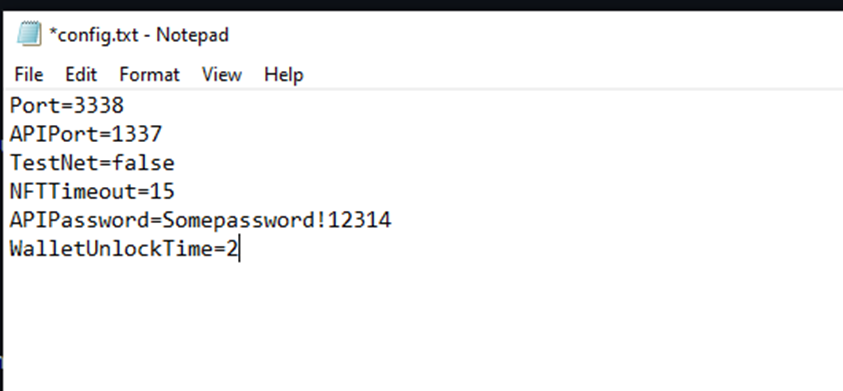
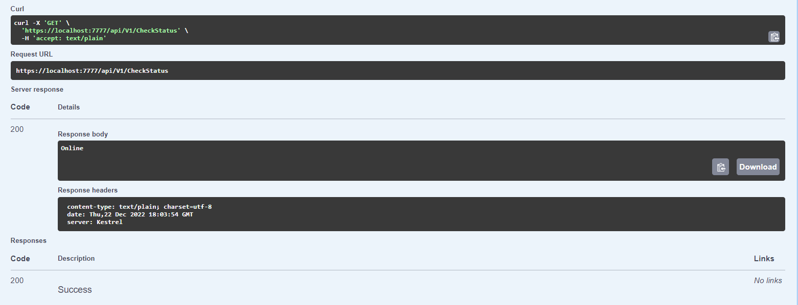
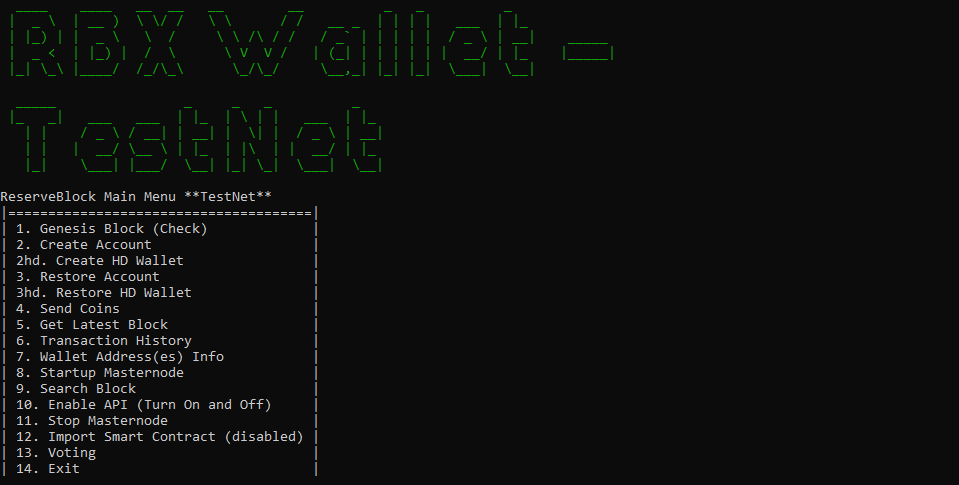
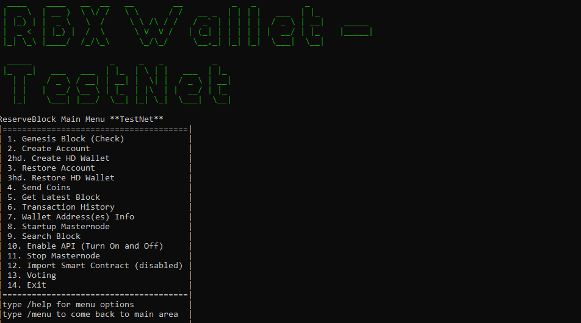
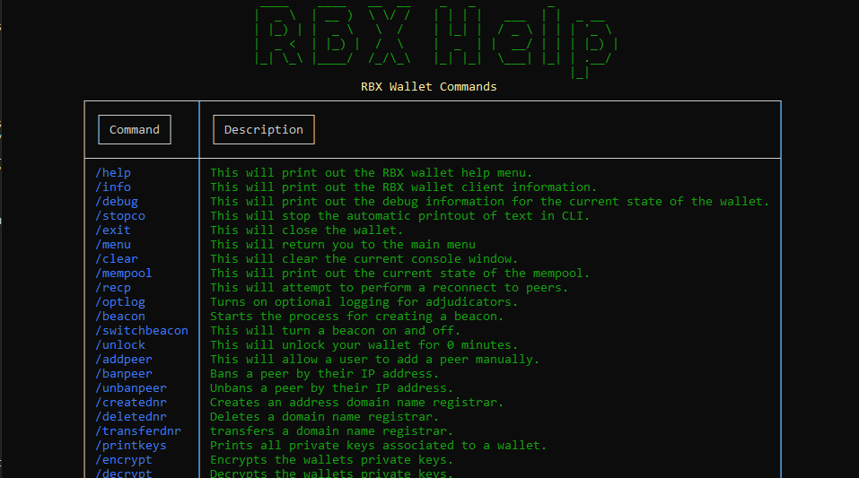

## Resumen

Este documento está dirigido a todos los integradores externos, incluidos, entre otros, exchanges, API de terceros, exploradores, herramientas web y billeteras web, y cualquier otro producto integrable al que pueda conectarse el CLI de Core.

Este documento describe las funciones del CLI de Core y ofrece prácticas recomendadas. Ten en cuenta que siempre debes seguir los niveles de seguridad más altos según tu propio entorno. Este documento es solo una guía para que empieces a funcionar.


## Información de la billetera

Actualmente VFX tiene una billetera con interfaz gráfica (GUI) y una billetera CLI. Estas billeteras funcionan en todos los entornos **(windows, linux y mac)**.
VFX Core se creó con **.Net 6 y C#.**
VFX GUI se creó con **Flutter/Dart**

> Puedes encontrar .Net 6 aquí: [https://dotnet.microsoft.com/en-us/download/dotnet/6.0](https://dotnet.microsoft.com/en-us/download/dotnet/6.0)

> El IDE recomendado para VFX es Visual Studio 2022 o Visual Code.

> Para entornos de producción se recomienda ejecutar el CLI y comunicarse a través de la API. Para uso personal, la billetera GUI es más que suficiente.

**Puedes encontrar binarios precompilados aquí:**  
CLI - [https://github.com/VerifiedXBlockchain/VerifiedX-Core/releases](https://github.com/VerifiedXBlockchain/VerifiedX-Core/releases)  
GUI - [https://github.com/VerifiedXBlockchain/VerifiedX-GUI/releases](https://github.com/VerifiedXBlockchain/VerifiedX-GUI/releases)

Si quieres compilar desde el código fuente, elige el repositorio correcto aquí:
**https://github.com/ReserveBlockIO**

La billetera de VFX genera direcciones basadas en la curva ECDSA.

Las direcciones de mainnet empiezan con una `R`.
Las direcciones de testnet empiezan con una `x`.

Para la capa P2P de VFX, la billetera usa SignalR. Puedes encontrar más información sobre SignalR aquí: **https://dotnet.microsoft.com/en-us/apps/aspnet/signalr**

Para los beacons y la transferencia de archivos, la billetera usa su propia versión modificada de un listener TCP con un manejador de sockets. Esto permite que ambas funciones trabajen juntas sin interferir entre sí al mismo tiempo.

La billetera es una aplicación multihilo. El rendimiento normal ha sido estable con 2 núcleos de CPU y 2 GB de RAM. Usar menos de lo recomendado puede ralentizar el rendimiento. Una configuración ideal es de 3 o más núcleos de CPU y 4 GB de RAM. Tu sistema operativo también influye en esto. Por ejemplo, como Windows necesita más recursos, quizás quieras más; en cambio, un Linux sin interfaz gráfica requiere menos.

El puerto de conexión principal de la billetera, 3338, debe configurarse para permitir al menos las conexiones salientes. Si no quieres que otros se conecten a ti, simplemente no abras ese puerto a conexiones entrantes.

## Compila tu propio CLI

Si quieres compilar tu propio CLI desde el código fuente, así es como se hace.  
Las instrucciones de abajo también están aquí: [Instrucciones de compilación](/es/node/build-from-source/)

### Linux

Instalación en Linux para Ubuntu 22.04:

1. `sudo apt-get update && sudo apt-get install -y dotnet-sdk-6.0`
2. `sudo apt-get update && sudo apt-get install -y aspnetcore-runtime-6.0`
3. ejecuta `dotnet --version`. Deberías ver un número de versión 6.0.xxx
4. `mkdir vfx`: crea un directorio para VFX
5. cd vfx
6. - Clona el repositorio con git. `git clone https://github.com/VerifiedXBlockchain/VerifiedX-Core.git`
   - Descarga la versión ya empaquetada https://github.com/VerifiedXBlockchain/VerifiedX-Core/releases/. Si haces esto, ve a la carpeta donde descargaste los binarios y salta al paso 12.
7. `cd VerifiedX-Core`
8. `dotnet build`: debería haber 0 (cero) errores.
9. `dotnet publish -c Release -r linux-x64 --output ./rbxpublished`
   > Ten en cuenta que puedes cambiar `linux-x64` si usas otra arquitectura, como arm o x86.
10. `cd rbxpublished`
11. `dotnet VerifiedXCore.dll`

Con esto terminaste. La billetera estará en ejecución. Para activar la API, simplemente escribe ‘10’ y presiona Enter, o pásalo como argumento del comando.

`dotnet VerifiedXCore.dll enableapi`

¡Listo! Ahora deberías ver una billetera en ejecución. Algunos errores comunes suelen estar relacionados con los permisos de archivos. Asegúrate de haber dado los permisos adecuados a la carpeta RBX recién creada

### Windows

1. Instala el SDK de dotnet más reciente desde aquí: **https://dotnet.microsoft.com/en-us/download/dotnet/6.0** Cuando esté instalado, sigue los pasos de abajo.

2. Crea un directorio para RBX y luego abre el símbolo del sistema como administrador y ve a ese directorio.
3. Asegúrate de tener instalada una versión funcional de git.
4. - Clona el repositorio con git. `git clone https://github.com/VerifiedXBlockchain/VerifiedX-Core.git`
   - Descarga la versión ya empaquetada https://github.com/VerifiedXBlockchain/VerifiedX-Core/releases/. Si haces esto, ve a la carpeta donde descargaste los binarios y salta al paso 8.
5. `cd VerifiedX-Core`
6. `dotnet build`: debería haber 0 (cero) errores.
7. `dotnet publish -c Release -r win-x64 --output ./rbxpublished`
   > ten en cuenta que puedes cambiar `win-x64` si usas otra arquitectura
8. `cd rbxpublished`
9. `dotnet VerifiedXCore.exe`

### Mac OS X

1. Instala el SDK de dotnet más reciente desde aquí: **https://dotnet.microsoft.com/en-us/download/dotnet/6.0** Cuando esté instalado, sigue los pasos de abajo.
2. Crea un directorio para RBX y luego abre el símbolo del sistema como administrador y ve a ese directorio.
3. Asegúrate de tener instalada una versión funcional de git.
4. - Clona el repositorio con git. `git clone https://github.com/VerifiedXBlockchain/VerifiedX-Core.git`
   - Descarga la versión ya empaquetada **https://github.com/VerifiedXBlockchain/VerifiedX-Core/releases/**. Si haces esto, ve a la carpeta donde descargaste los binarios y salta al paso 8.
5. `cd VerifiedX-Core`
6. `dotnet build`: debería haber 0 (cero) errores.
7. `dotnet publish -c Release -r osx-x64 --output ./rbxpublished`
   > ten en cuenta que puedes cambiar 'osx-x64' si usas otra arquitectura, como arm.
8. `cd rbxpublished`
9. `dotnet VerifiedXCore`, a veces dotnet VerifiedXCore.dll. Depende de la configuración actual del entorno.

## Configuración de la billetera

### Resumen

El objetivo de este documento es describir la configuración del archivo de configuración y las opciones que tiene.

1. Port (el valor predeterminado es 3338)

   - Tipo `int`
   - Ej.: `Port=3338.`
   - Es el puerto para todas las funciones p2p. Debe quedarse en 3338.

2. APIPort (el valor predeterminado es 7292)

   - Tipo `int`
   - Ej.: `APIPort=7292`
   - Es el puerto para llamar a la API. Puedes cambiarlo al que quieras.

3. WalletPassword (el valor predeterminado es null)

   - Tipo `string`
   - Ej.: `WalletPassword=SomePassword1234!`
   - Es una contraseña que bloquea todas las funciones de la billetera y te pide ingresar una contraseña para desbloquearlas.

4. AlwaysRequireWalletPassword (el valor predeterminado es false)

   - Tipo `boolean`
   - Ej.: `AlwaysRequireWalletPassword=true`
   - Si se establece en true, tendrás que ingresar la contraseña antes de cada llamada a una función.

5. APIPassword (el valor predeterminado es null)

   - Tipo `string`
   - Ej.: `APIPassword=SomePassword1234!`
   - Es una contraseña que restringe el control de la API. Hay que ingresarla para llamar a cualquier función de la API.
   - Tienes que llamar a UnlockWallet para desbloquear la API con esta contraseña.

6. AlwaysRequireAPIPassword (el valor predeterminado es false)

   - Tipo `boolean`
   - Ej.: `AlwaysRequireAPIPassword=true`
   - Si se establece en true, debes incluir la contraseña en todas las solicitudes a la API.

7. APICallURL (el valor predeterminado es null)

   - Tipo `string`
   - Ej.: `APICallURL=https://mycallbackurl.com`
   - Esta URL se usa para enviar las transacciones entrantes a una URL externa. Se usa, por ejemplo, para depósitos entrantes u otros servicios de notificación.

8. WalletUnlockTime (el valor predeterminado es 15)

   - Tipo `int`
   - Ej.: `WalletUnlockTime=5`
   - Es el tiempo que la billetera permanece desbloqueada después de ingresar una contraseña, sin volver a pedirla. Si alguna de las opciones RequirePassword anteriores está en true, anula esta opción y pide la contraseña cada vez.

9. ChainCheckPoint (el valor predeterminado es false)

   - Tipo `Boolean`
   - Ej.: ChainCheckPoint=true
   - Esta opción activa los puntos de control de la cadena. Crea una copia COMPLETA del estado de la cadena, la respalda y crea un punto de control al que puedes volver si tu estructura actual se corrompe.

10. ChainCheckPointInterval (el valor predeterminado es 12)

    - Tipo `int`
    - Ej.: `ChainCheckPointInterval=4`
    - Este intervalo está en horas y significa que el punto de control se ejecuta cada X horas; el mínimo permitido es 1.

11. ChainCheckPointRetain (el valor predeterminado es 2)

    - Tipo `int`
    - Ej.: `ChainCheckPointRetain=4`
    - Retain determina cuántos respaldos se conservan antes de empezar a eliminar el más antiguo para dejar espacio al nuevo.

12. ChainCheckPointLocation (el valor predeterminado es la ruta predeterminada)

    - Tipo `string`
    - Ej.: `ChainCheckPointLocation=C:\somelocation\otherthan\default\`
    - Si no quieres usar la ruta predeterminada, puedes configurar una nueva ubicación para los respaldos.

13. APICallURLLogging (el valor predeterminado es false)

    - Tipo `Boolean`
    - Ej.: `APICallURLLogging=true`
    - Registra información de depuración de la URL de llamada de la API por si hay algún problema con las transacciones que se envían a tu URL. Se recomienda activarlo durante las pruebas iniciales de tu URL.

14. ValidatorAddress (el valor predeterminado es null)

    - Tipo `string`
    - Ej.: `ValidatorAddress=RBcHyS2AF4Z4jgzTLZNBVLvtxQ6MtB2vUN`
    - Puedes ingresar una dirección de validador (validator) predeterminada para empezar a validar de inmediato. Ten en cuenta que también debes importar la dirección de la billetera con los comandos de inicio. Ej.: VerifiedXCore.exe privKey=MyPrivateKey.

15. ValidatorName (el valor predeterminado es un guid nuevo)

    - Tipo `string`
    - Ej.: `ValidatorName=MyValidatorVFX1`
    - Es el nombre que se usará para el validador anterior. Una vez que el validador se haya importado, estas opciones ya no tienen efecto y puedes eliminarlas o dejarlas.

16. NFTTimeout (el valor predeterminado es 15 s)

    - Tipo `int`
    - Ej.: `NFTTimeout=5`
    - Controla el tiempo de espera para procesar un NFT entrante

17. PasswordClearTime (el valor predeterminado es 10 min)

    - Tipo `int`
    - Ej.: `PasswordClearTime=5`
    - Controla el tiempo tras el cual se borra la contraseña de una billetera cifrada

18. AutoDownloadNFTAsset (el valor predeterminado es true)
    - Tipo `Boolean`
    - Ej.: `AutoDownloadNFTAsset=false`
    - Controla si el archivo de un NFT se descarga automáticamente
19. IgnoreIncomingNFTs (el valor predeterminado es false)

    - Tipo `Boolean`
    - Ej.: `IgnoreIncomingNFTs=false`
    - Controla si los NFTs entrantes se procesan o solo se agregan como registro de transacción

20. RejectAssetExtensionTypes (el valor predeterminado es una lista de archivos rechazados)

    - Tipo `List of string`
    - Ej.: `RejectAssetExtensionTypes=exe,zip,pdf...` (asegúrate de que no haya espacios entre los tipos)
      --Agrega tipos de extensión a la lista ya definida y rechaza cualquier archivo de NFT con esas extensiones

21. AllowedExtensionsTypes (el valor predeterminado es null)
    - Tipo `List of string`
    - Ej.: `AllowedExtensionsTypes=pdf,doc,xls`
    - Quita tipos de extensión de la lista ya definida y permite descargar cualquier archivo de NFT con esas extensiones

Un ejemplo de configuración podría verse así:


> Esta información se actualiza cada vez que se agregan funciones nuevas y está disponible aquí:
> **https://github.com/VerifiedXBlockchain/VerifiedX-Core/blob/main/ConfigSetup.md**

## Conexión a la interfaz RPC

#### Mainnet : http://localhost:7292/

#### TestNet: http://localhost:17292/

> Puedes cambiar los puertos anteriores en el documento de configuración.

La opción de configuración es APIPort=[Ingresa el nuevo número de puerto, sin corchetes]

Ejemplo: APIPort=1337

Los puertos predeterminados son:

Mainnet : 7292
Testnet : 17292

El CLI de Core tiene cinco endpoints de API en total. Son los siguientes:

1. Beacons - /bcapi/BCV1
2. Contratos inteligentes - /scapi/SCV1
3. Transacciones - /txapi/TXV1
4. General - /api/V1
5. Votación - /voapi/VOV1

## Configuración de la interfaz RPC

Antes de conectarte con RPC, asegúrate de tener la configuración que quieres.

Las principales opciones de configuración son las siguientes:

1. APIPort
   - Cambia el puerto predeterminado de la API por otro
   - `APIPort=1337`
2. APIPassword
   - Crea una contraseña de API para acceder a todos los endpoints. La contraseña se guarda durante 15 minutos o el tiempo que indique WalletUnlockTime
   - `APIPassword=SomePassword123!`
3. AlwaysRequireAPIPassword
   - Hace que la contraseña sea obligatoria en cada llamada, sin importar WalletUnlockTime
   - `AlwaysRequireAPIPassword=true`
4. APICallURL
   - Es una URL personalizada a la que se llama cada vez que se recibe una transacción para entregar esa información
   - `APICallURL=http://somecustomurl.com/api/`
5. WalletUnlockTime
   - Define, en minutos, el tiempo que una contraseña mantiene desbloqueada la billetera después de ingresarla
   - `WaleltUnlockTime=5`

## Interfaz RPC

El CLI de Core de RBX usa una interfaz basada en json. Tienes que crear algún tipo de solicitud de cliente Http y enviar “application/json” a la interfaz. Luego tienes que esperar un resultado (post) del cliente.

La mejor forma de probar la interfaz es usar Swagger.

Swagger está en esta ubicación:

Mainnet: http://localhost:7292/swagger/index.html
Testnet: http://localhost:17292/swagger/index.html
Cada endpoint de la API tiene una lista de métodos con una descripción. Algunos de los endpoints más usados son los siguientes:

```
/api/V1/
    CheckStatus
    CheckPasswordNeeded
    GetIsWalletEncrypted
    GetIsEncryptedPasswordStored
    GetEncryptWallet/{password}
    GetDecryptWallet/{password}
    GetEncryptLock
    GetCLIVersion
    GetWalletInfo
    GetAllAddresses
    GetValidatorAddresses
    getgenesisblock
    ImportPrivateKey
    GetNewAddress
    SendTransaction/{from}/{to}/{amount}
    StartValidating/{address}/{username}
    TurnOnValidator/{id}
    TurnOffValidator/{id}
    GetValidatorInfo/{address}
    SendBlock/{height}
    GetMasternodes
    GetPeerInfo
    GetDebugInfo
    GetRollbackBlocks/{id}
    SendExit
    ClearRBXLog
    ChangeValidatorName/{name}

===================

/voapi/VOV1/
    GetAllTopics
    GetActiveTopics
    GetInactiveTopics
    GetMyTopics
    GetSearchTopics/{search}

    GetTopicDetails/{topicUid}
    GetMyVotes
    GetTopicVotes/{topicUid}
    CastTopicVote/{topicUid}/{vote}

===================

/scapi/scv1/
    GetAllSmartContracts
    GetAllSmartContracts/{page}/{search}
    GetMintedSmartContracts/{page}/{search}
    GetSingleSmartContract/{id}
    ChangeNFTPublicState/{id}
    GetSmartContractData/{id}
    CreateSmartContract
    MintSmartContract/{id}
    TransferNFT/{id}/{address}
    TransferNFT/{id}/{address}/{url}
    EvolveSpecific/{id}/{address}/{stage}
    Burn/{id}
    AssociateNFTAsset/{id}/{path}
    DownloadNftAssets/{id}
    GetNFTAssetLocation/{id}/{filename}


===================

/bcapi/BCV1/
    GetBeacons
    AddBeacon/{name}/{port}/{ip}
    CreateBeacon/{name}/{port}
    DeleteBeacon/{id}

====

/txapi/txV1/
    CreateAdnr/{address}/{name}
    TransferAdnr/{from}/{to}/
    DeleteAdnr/{address}
```

### Ejemplo

Un ejemplo corto sería el siguiente (C#)

```csharp
HttpClient client = new HttpClient();
string json = JsonConvert.SerializeObject(mainSc).Dump();
var httpContent = new StringContent(json, Encoding.UTF8, "application/json");
var httpResponse = await client.PostAsync("http://localhost:7292/api/V1/CheckStatus", httpContent);

var responseString = await httpResponse.Content.ReadAsStringAsync();
```

El resultado es el siguiente: un cuerpo de respuesta `Online`


El ejemplo con curl es el siguiente:

```
curl -X 'GET' \
  'http://localhost:7292/api/V1/CheckStatus' \
  -H 'accept: text/plain'
```

Otro ejemplo básico en Go es el siguiente:

```go
package main

import (
    "fmt"
    "net/http"
    "io/ioutil"
    "os"
    )

func main() {
    response, err := http.Get("http://localhost:7292/api/v1/CheckStatus")
    if err != nil {
        fmt.Printf("%s", err)
        os.Exit(1)
    } else {
        defer response.Body.Close()
        contents, err := ioutil.ReadAll(response.Body)
        if err != nil {
            fmt.Printf("%s", err)
            os.Exit(1)
        }
        fmt.Printf("%s\n", string(contents))
    }
}
```

## Información de testnet

Inicia el nodo con el argumento `testnet` para ejecutarlo en testnet:

- Ej.: `reserveblockcore.exe testnet`

El argumento de inicio `testnet` es la única forma de seleccionar testnet. No configures `TestNet=true` ni `TestNetName` en `config.txt` por tu cuenta: un nodo que se inicia sin el argumento `testnet` y cuyo `config.txt` selecciona testnet se cierra al arrancar con un error que te indica usar el argumento.



Asegúrate de estar en testnet para no cometer errores con tus cuentas de mainnet.
Las direcciones de VFX en testnet SIEMPRE empiezan con una `x`. Por ejemplo:
`xC1zNn7596TC4Bcyn1vE88pj12hfieqCoa`

Hay tres formas de obtener fondos de testnet:

1. Usa el faucet de testnet en el explorador (https://spyglass-testnet.verifiedx.io/faucet). Entrega VFX de testnet y BTC de signet después de una verificación por SMS. Consulta [Testnet](/es/build/testnet/#obtén-fondos-de-prueba).
2. Escribe en el canal de Discord llamado `Testnet Faucet` con tu dirección y te enviarán los fondos.
3. Contacta a tu persona de contacto por tu herramienta de chat actual (telegram, skype, email, etc.) y pídele que envíe fondos a la dirección de testnet que indiques.

Se recomienda empezar con testnet para asegurarte de que todas las funciones trabajan con tu entorno antes de pasar a mainnet.

## El CLI



El CLI de VFX se recomienda para la mayoría de los integradores empresariales o externos, ya que se ejecuta sin interfaz gráfica y de la forma más eficiente.

El CLI es bastante robusto: las opciones del menú principal se ven arriba y puedes descubrir más opciones si escribes /help y presionas Enter.

Por ejemplo:

Una vez que el CLI está iniciado, puedes escribir comandos en cualquier momento e interactuar con la billetera sin preocuparte por detener ninguno de los procesos en segundo plano. Cerrar la billetera es lo único que detiene todas las funciones.

La billetera debe quedar abierta para que todo siga funcionando. Si usas Linux y SSH, se recomienda usar screen u otra herramienta para mantenerla en ejecución.

Ejemplo con screen:
screen dotnet VerifiedXCore.dll

> `ctrl A & ctrl D`
> para desconectarte de la sesión de screen.

> para volver, escribe `screen -r` y presiona Enter.

## Integración de terceros para exchanges y otras entidades

### Resumen

Esta sección describe las mejores prácticas para configurar una billetera de VFX en tu entorno. Aunque muchas de estas funciones son opcionales, se recomienda aprovechar tantas como puedas, si no todas.

La sección cubre la configuración de config.txt, la configuración de contraseñas y cómo usar la API en algunos escenarios comunes y generales que se ajustan a la mayoría de los entornos.

La arquitectura de VFX sigue muy de cerca las filosofías y los principios de Bitcoin, así que la integración también es muy parecida. Esto se hizo a propósito para aliviar la carga de la solución y por el hecho de que es una layer 1.

### Compila el proyecto

Según tu entorno, encontrarás instrucciones de compilación para Windows, Linux y Mac aquí: **https://github.com/VerifiedXBlockchain/VerifiedX-Core/blob/main/RBXBuildInstructions.md**

Sigue las instrucciones: puedes compilar el proyecto desde el código fuente para asegurarte de recibir una versión limpia del programa, o puedes usar un binario publicado en la sección de versiones aquí: **https://github.com/VerifiedXBlockchain/VerifiedX-Core/releases**

### Configuración del archivo de configuración (Config.txt)

Puedes ver la lista completa de opciones de configuración aquí: **https://github.com/VerifiedXBlockchain/VerifiedX-Core/blob/main/ConfigSetup.md**

Primero, inicia la billetera para generar un archivo de configuración predeterminado. Según tu entorno, estará en la misma carpeta que la carpeta de la base de datos.

Lo primero es cambiar el APIPort y definir una APIPassword. Puedes elegir que la contraseña de la API se pida siempre; si no, la API queda desbloqueada durante 15 minutos de forma predeterminada. Puedes cambiar eso con el comando WalletUnlockTime.

Aquí también puedes configurar una contraseña de billetera si planeas enviar comandos directamente al CLI. Un ejemplo podría verse así:


Estas son las opciones de configuración más relevantes:

1. Port (el valor predeterminado es 3338)

   - Tipo int
   - Ej.: `Port=3338.`
   - Es el puerto para todas las funciones p2p. Debe quedarse en 3338.

2. APIPort (el valor predeterminado es 7292)

   - Tipo int
   - Ej.: `APIPort=7292`
   - Es el puerto para llamar a la API. Puedes cambiarlo al que quieras.

3. WalletPassword (el valor predeterminado es null)

   - Tipo string
   - Ej.: `WalletPassword=SomePassword1234!`
   - Es una contraseña que bloquea todas las funciones de la billetera y te pide ingresar una contraseña para desbloquearlas.

4. AlwaysRequireWalletPassword (el valor predeterminado es false)

   - Tipo boolean
   - Ej.: `AlwaysRequireWalletPassword=true`
   - Si se establece en true, tendrás que ingresar una contraseña antes de cada llamada a una función.

5. APIPassword (el valor predeterminado es null)

   - Tipo string
   - Ej.: `APIPassword=SomePassword1234!`
   - Es una contraseña que restringe el control de la API. Hay que ingresarla para llamar a cualquier función de la API.

6. AlwaysRequireAPIPassword (el valor predeterminado es false)

   - Tipo boolean
   - Ej.: `AlwaysRequireAPIPassword=true`
   - Si se establece en true, debes incluir la contraseña en todas las solicitudes a la API.

7. APICallURL (el valor predeterminado es null)

   - Tipo string
   - Ej.: `APICallURL=https://mycallbackurl.com`
   - Esta URL se usa para enviar las transacciones entrantes a una URL externa. Se usa para depósitos entrantes u otros servicios de notificación.

8. WalletUnlockTime (el valor predeterminado es 15)

   - Tipo int
   - Ej.: `WalletUnlockTime=5`
   - Es el tiempo que la billetera permanece desbloqueada después de ingresar una contraseña, sin volver a pedirla. Si alguna de las opciones RequirePassword anteriores está en true, anula esta opción y pide la contraseña cada vez.

## APICallURL opcional

También puedes configurar una APICallURL. Es una URL que ingresas y a la que la billetera de VFX llama cada vez que recibe una nueva transacción entrante, enviando una respuesta json que sigue el modelo de transacción. Esto te permite recibir las transacciones entrantes de forma fácil, en tiempo real y de inmediato.

## Configura la billetera y el cifrado de claves privadas

Puedes configurar una billetera simplemente abriendo la billetera de VFX. Desde ahí puedes generar un número infinito de direcciones o configurar una frase de recuperación de 24 palabras para crear una billetera HD.

Se recomienda respaldar tu frase fuera de línea o crearla en un entorno aislado (air gapped).
Se recomienda encarecidamente cifrar tus claves privadas. Esto te protege: si roban los archivos de tu base de datos, no podrán acceder a los fondos porque las claves privadas estarán cifradas.
Para cifrar tus claves privadas, simplemente llama a /encrypt en la billetera y sigue las instrucciones. Te pedirá escribir una contraseña dos veces para confirmar que es correcta. Al inicio se generarán automáticamente 1000 direcciones. Si necesitas más, no hay problema.

Solo necesitas escribir una contraseña cuando quieras hacer algo con una clave privada. Las dos funciones principales son enviar una transacción o firmar un mensaje. Este proceso es muy parecido al de Bitcoin y, si ya lo haces, no notarás ninguna diferencia.
Cuando escribes tu contraseña, se guarda como SecureString durante 10 minutos, salvo que se indique otra cosa. Después de 10 minutos se ejecuta el recolector de basura (garbage collection) y la contraseña se borra tanto de la aplicación como de la RAM del sistema.

## Uso general

A partir de aquí, cómo integras tu aplicación o tus sistemas depende de tu entorno actual. El endpoint de Swagger tiene todas las API necesarias para integrar y para todos los casos de uso. Si eres un exchange, una posible ruta es la siguiente:

1. Genera todas tus direcciones de depósito
2. Guarda las direcciones en memoria en una lista.
3. Haz una verificación cada 30 a 60 segundos
   - Revisa cada bloque nuevo contra la lista guardada en el paso 2 y comprueba si hay transacciones entrantes. Si las hay, tienes un nuevo depósito
   - Mantén una lista de todos los hashes de transacción y luego ejecuta un escaneo desde la última verificación con una marca de tiempo; si aparece algún hash nuevo que no tienes guardado, también sabes que tienes un nuevo depósito.
4. Acredita la cuenta asociada a la dirección de depósito.
5. Para los retiros, simplemente verifica los fondos contra tu propia base de datos y ejecuta una llamada a la API SendTransaction/.

El ejemplo anterior es un caso de uso simple para procesar depósitos entrantes. Si tu entorno tiene necesidades especiales, obviamente se agregarían, pero el modelo anterior funciona.

Puedes intentar usar la APICallURL, que envía una nueva transacción cada vez que se detecta una, pero solo desde la perspectiva de los depósitos, ya que para un retiro no tendría sentido.

Si tienes alguna necesidad o pregunta específica, se recomienda contactar por discord o por la herramienta de chat que uses actualmente, como telegram, skype, email, etc.

## Conclusión

Este documento pondrá en marcha la mayoría de las integraciones en la dirección correcta. Sin embargo, no dudes en contactar a la comunidad y a los desarrolladores de VFX por discord o, si ya estás hablando con alguien por otros canales sociales, contáctalo ahí con cualquier pregunta.
