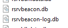
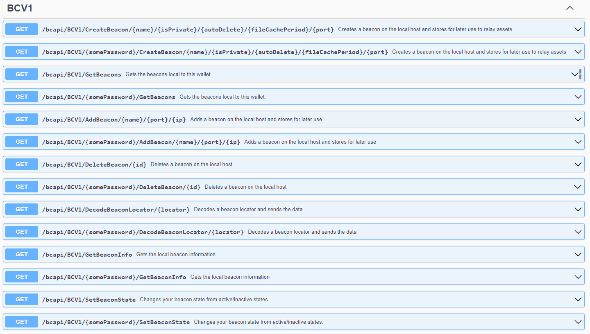

## Resumen

El propósito de este documento es enseñarte a crear un beacon desde el CLI de VFX. Ten en cuenta que en este proceso nunca necesitas exponer tu clave privada a la billetera ni a ningún lugar fuera de tu propia aplicación.

Crear un beacon es un proceso bastante sencillo y, al terminar este documento, tendrás toda la información necesaria para convertirte en tu propio beacon.

## Primero, ¿qué es un beacon?

Un beacon es la herramienta subyacente de la red VFX que se usa para ayudar a transmitir los archivos multimedia asociados a un NFT. En cuanto a los archivos multimedia, los NFTs deben cumplir estas reglas:

1. El archivo puede pesar como máximo 150 MB
2. Solo puedes tener 26 recursos en total, más el recurso principal.
3. El tipo de extensión de tu archivo no debe estar en la lista de ignorados del remitente, del beacon ni del destinatario. (Esto ayuda a evitar la propagación de archivos maliciosos)

Si un NFT no cumple estas reglas, tu beacon rechazará el archivo multimedia y ese archivo no quedará asociado al NFT en tu beacon.

## ¿Cuáles son los estados de un beacon?

Un beacon tiene 3 estados:

1. Apagado o sin configurar
   - El beacon no está en ejecución y no aceptará ni transmitirá archivos.
2. Encendido (público)
   - Significa que tu beacon está en ejecución y aceptará recursos de NFT entrantes de cualquiera que intente transmitirlos.
3. Encendido (privado)
   - Un beacon privado es un beacon desde el cual solo tú puedes transmitir NFTs.
   - Las billeteras a las que envíes tus NFTs podrán llamar a tu beacon para recibir los archivos, pero no podrán enviar archivos para que el beacon los transmita.

## ¿Puedo agregar otros beacons?

Sí. Puedes agregar una cantidad ilimitada de beacons públicos para que tu billetera elija entre ellos. Los beacons se seleccionan, por lo general, según lo que indique el usuario y luego por región.

## ¿Necesito tener un beacon para enviar recursos de NFT?

La red tiene muchos beacons públicos entre los que tu nodo elegirá si no agregas ningún beacon ni alojas el tuyo.

Esto significa que puedes usar la billetera con la configuración predeterminada y podrás transmitir recursos de NFT a otros usuarios.

## ¿Cómo sabe mi billetera a qué beacon llamar?

La transacción incluye lo que se llama un localizador (Locator). Al transmitirse, este localizador revela el beacon que tiene los datos, y en ese momento puedes llamarlo para obtenerlos. La dirección debe enviar una firma para verificar que es la destinataria antes de que un beacon comience la transmisión.

## ¿Cómo configuro un beacon?

A continuación encontrarás los pasos para configurar un beacon.

Para iniciar el proceso de creación del beacon, escribe /beacon y presiona Enter en el CLI.

1. <ins>Please give your beacon a name</ins>

   - Es el nombre local que le darás a tu beacon.

2. <ins>Do you want to auto delete file cache after receiver downloads? (y for yes and n for no)</ins>

   - Esta opción determina si tu beacon elimina la caché de archivos una vez que un archivo se transmite correctamente.

3. <ins>Do you want this beacon to be private meaning only you can upload to it? (y for yes and n for no)</ins>

   - Si eliges sí, solo tú podrás usar tu beacon para transmitir recursos de NFT.

4. <ins>Do you want to cache files for a limited time? Please input a number. (0 is infinite, 5 is 5 days, 10 is 10 days, etc.)</ins>

   - Es la cantidad de días que estás dispuesto a guardar recursos de NFT en tu caché de datos antes de liberarlos; después de eso, quien envió el NFT tendrá que haber agregado una URL de respaldo o deberá enviar los archivos al destinatario para que pueda asociarlos a la billetera.

Si este proceso se hace correctamente, al final verás “Beacon Inserted. Please restart wallet for beacon to activate.”. Como se indica, es necesario reiniciar la billetera para que el beacon se active por completo. Esto se debe a que el transmisor del beacon debe quedar integrado en el software al iniciar y, a partir de ahora, siempre se ejecutará al iniciar.

## ¿Puedo desactivar mi propio beacon?

Sí. Escribe el comando `/switchbeacon` y presiona Enter. Esto enciende y apaga tu beacon local.

## ¿Es necesario abrir y redirigir algún puerto?

Sí. Para que un beacon funcione, asegúrate de que los siguientes puertos estén abiertos y redirigidos a la máquina.

Puertos:

- <ins>3338</ins>
- <ins>23338</ins>

Puedes comprobarlo fácilmente con cualquier verificador de puertos en línea: escribe tu IP y luego el puerto, con la billetera en ejecución después de configurar el beacon y reiniciar. Si el puerto aparece abierto, tu beacon está en ejecución. Si no, significa que hay uno de 3 problemas:

1. El puerto está bloqueado en el firewall local de la máquina y debe abrirse.
2. El puerto no está redirigido a través del router, switch o cualquier otro dispositivo de red en el que se encuentre la máquina que aloja la billetera.
3. El beacon no está encendido ni en ejecución.

## ¿Cómo sé si mi beacon está en ejecución?

1. Haz una comprobación de puertos con una herramienta en línea para asegurarte de que los puertos estén abiertos.
2. Escribe /beacon y presiona Enter. Si tu beacon está en ejecución y configurado, mostrará la información del beacon. Si no, te pedirá que vuelvas a hacer el proceso de configuración.

Si en algún momento sientes que configuraste mal tu beacon, otros beacons agregados o los beacons públicos de la red y quieres empezar de nuevo, simplemente elimina los dos archivos de beacon. A continuación se muestra una captura de pantalla.  
  
También hay una API completa para los beacons con la que puedes integrar fácilmente y realizar tareas más complejas. Puedes verla en `http://localhost:7292/swagger`

## ¿Cómo obtengo ayuda si la necesito?

Si alguna de las instrucciones anteriores no funciona o si tienes problemas, se recomienda contactar al Discord de la comunidad. Hay muchos desarrolladores y miembros de la comunidad que con gusto te ayudarán. El enlace está arriba, en la primera página.
